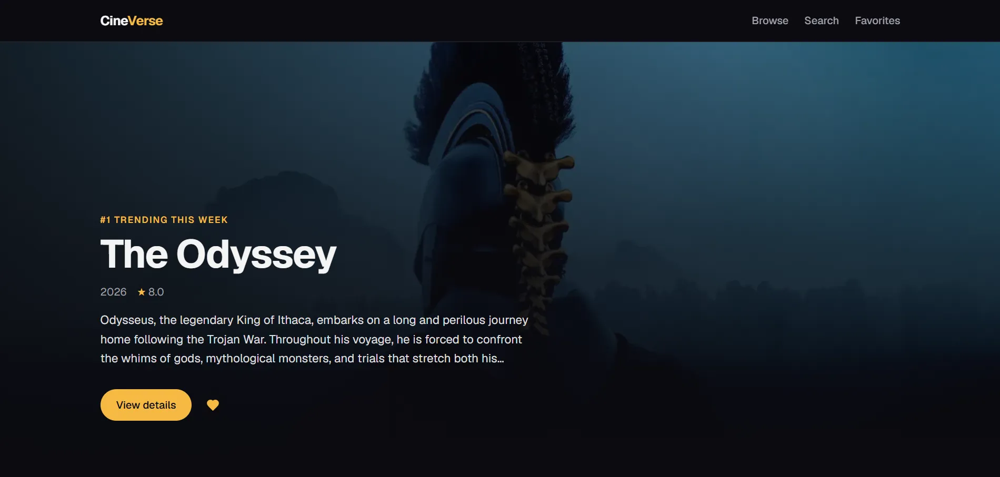
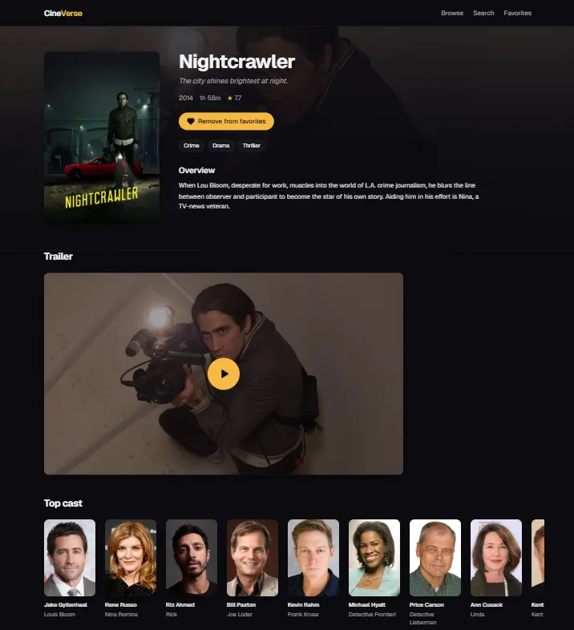
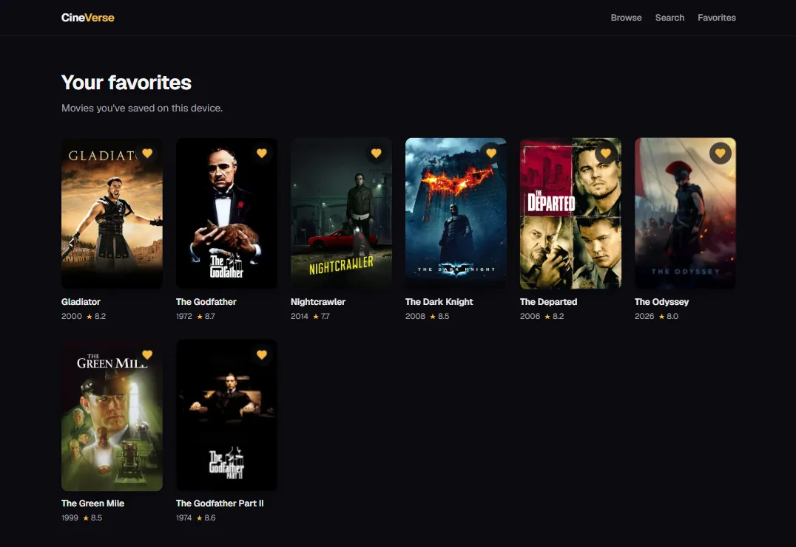
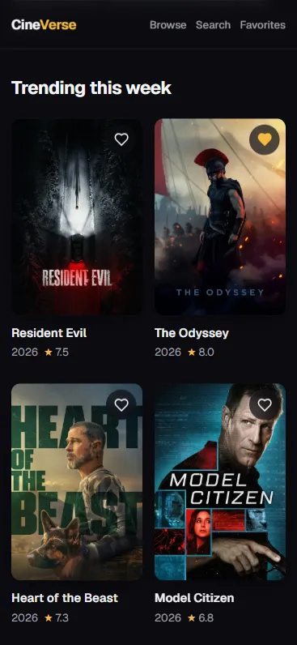

# CineVerse

A movie discovery app built with Next.js and the [TMDB API](https://www.themoviedb.org/documentation/api). Browse popular and trending movies, search, filter by genre, view details, and save favorites.

**Live demo:** [cineverse-three-eta.vercel.app](https://cineverse-three-eta.vercel.app/)

## Screenshots






## Tech Stack

- [Next.js](https://nextjs.org/) (App Router) and React
- TypeScript
- Tailwind CSS
- Zustand (client state)
- TMDB API (data source)

## Features

- [x] Popular and trending movies
- [x] Featured movie hero on the home page
- [x] Movie details page
- [x] Cast, trailer and recommendations on movie details
- [x] Search with debounced input
- [x] Genre filtering and pagination
- [x] Favorites (persisted in localStorage)
- [x] Responsive layout
- [x] Deployment on Vercel

## Getting Started

### Prerequisites

- Node.js 20 or newer
- A free [TMDB account](https://www.themoviedb.org/signup) and an **API Read Access Token** (Settings → API)

### Installation

```bash
git clone https://github.com/otonebieridze/cineverse.git
cd cineverse
npm install
```

### Environment variables

Copy the example file and add your token:

```bash
cp .env.example .env.local
```

| Variable           | Description                          |
| ------------------ | ------------------------------------ |
| `TMDB_ACCESS_TOKEN` | TMDB API Read Access Token (server-only) |

### Run the app

```bash
npm run dev
```

Open [http://localhost:3000](http://localhost:3000).

## Scripts

| Command         | Description                      |
| --------------- | -------------------------------- |
| `npm run dev`   | Start the development server     |
| `npm run build` | Create a production build        |
| `npm run start` | Run the production build         |
| `npm run lint`  | Run ESLint                       |

## Deployment

The app is deployed on [Vercel](https://vercel.com/):

1. Import the GitHub repository in Vercel. The Next.js preset needs no extra configuration.
2. Under **Settings → Environment Variables**, add `TMDB_ACCESS_TOKEN` for **Production** and **Preview** before the first build. Pages are prerendered at build time and call TMDB, so the build fails without it.
3. Deploy. Every push to `main` triggers a production deployment, and pull requests get preview deployments.

## Architecture Notes

- **Server-side data fetching.** All TMDB requests run on the server, so the access token is never exposed to the browser (no `NEXT_PUBLIC_` prefix).
- **Caching.** TMDB requests are cached with the `"use cache"` directive and a `cacheLife` profile chosen per endpoint (hours for lists and search, days for movie details, weeks for genres) to keep navigation fast and reduce API calls.
- **Server Components by default.** `"use client"` is used only for interactive parts such as search, filters, and favorites.
- **Click-to-load trailers.** The details page shows a lightweight preview with a play button. The privacy-enhanced YouTube embed (`youtube-nocookie.com`) loads only after the user presses play.

## Acknowledgements

This product uses the TMDB API but is not endorsed or certified by [TMDB](https://www.themoviedb.org/).
