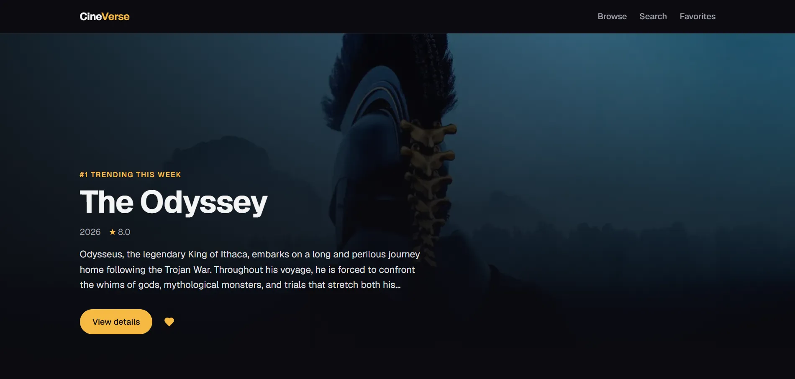
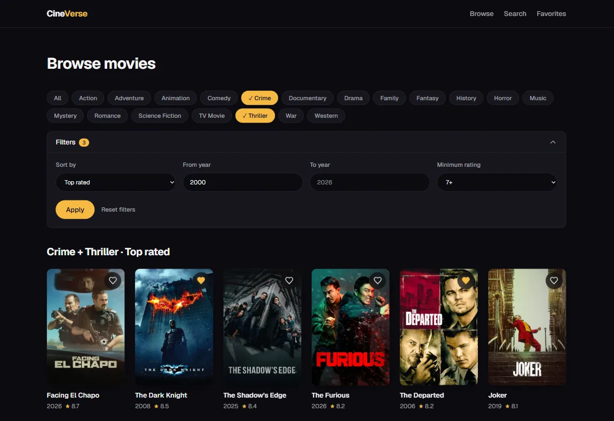
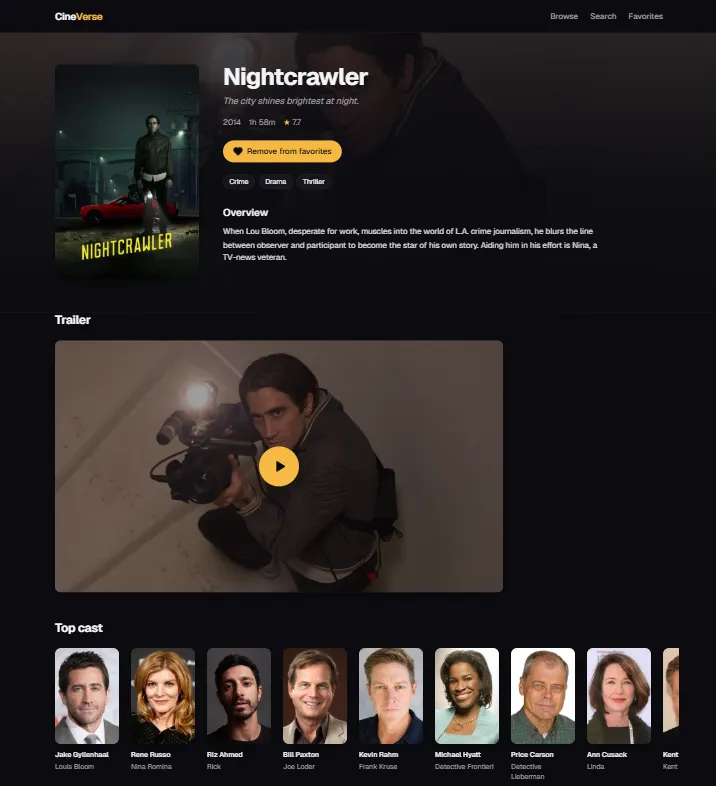
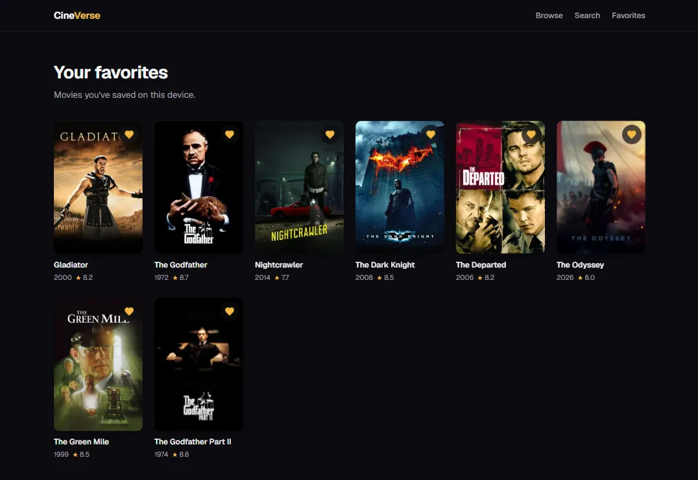
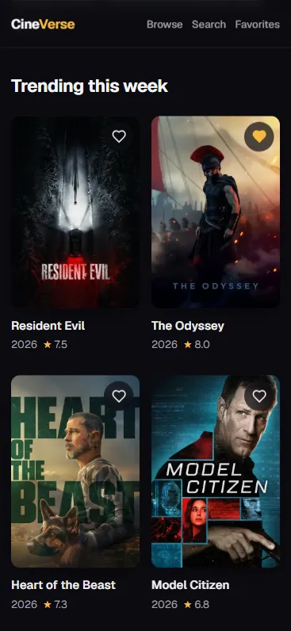

# CineVerse

[](https://github.com/otonebieridze/cineverse/actions/workflows/ci.yml)

A movie discovery app built with Next.js and the [TMDB API](https://www.themoviedb.org/documentation/api). Browse popular and trending movies, search, filter and sort, view details, and save favorites.

**Live demo:** [cineverse-three-eta.vercel.app](https://cineverse-three-eta.vercel.app/)

## Screenshots



*Home: featured hero banner*



*Browse: sort, year range, minimum rating and multi-genre filters*



*Details: click-to-load trailer, cast and recommendations*



*Favorites: saved movies, persisted in the browser*



*Mobile: responsive layout with the hero banner*

## Tech Stack

- [Next.js](https://nextjs.org/) (App Router) and React
- TypeScript
- Tailwind CSS
- Zustand (client state)
- TMDB API (data source)
- [Vitest](https://vitest.dev/) and [React Testing Library](https://testing-library.com/docs/react-testing-library/intro/) (unit and component tests)
- [Playwright](https://playwright.dev/) and [axe-core](https://github.com/dequelabs/axe-core) (end-to-end and accessibility tests)
- [GitHub Actions](https://github.com/features/actions) (CI) and [Vercel](https://vercel.com/) (hosting)

## Features

- [x] Popular and trending movies
- [x] Featured movie hero on the home page
- [x] Movie details page
- [x] Cast, trailer and recommendations on movie details
- [x] Cast row with scroll snapping, arrow buttons and keyboard and swipe support
- [x] Search with debounced input
- [x] Genre filtering and pagination
- [x] Advanced filters: sort, year range, minimum rating, multiple genres (shareable URLs)
- [x] Favorites (persisted in localStorage)
- [x] Responsive layout
- [x] Current page marked in the main navigation (`aria-current`, not color alone)
- [x] SEO: descriptive titles, meta description and per-page Open Graph tags
- [x] TMDB requests time out after 8 seconds and show a "Try again" page instead of loading forever
- [x] Accessibility: skip link and automated axe checks in CI
- [x] Deployment on Vercel

**Lighthouse** (mobile, live site, median of 3 runs, November 2026): Performance 96–99, Accessibility 100, Best Practices 100, and SEO 100 on every main page except movie details (91).

Movie details scores 91 because Next.js streams its TMDB-based meta description into `<body>`, where Lighthouse doesn't look. Googlebot reads it there, and crawlers that don't run JavaScript get it in `<head>`.

## Getting Started

### Prerequisites

- Node.js 24 (see `.nvmrc`; CI uses the same version)
- A free [TMDB account](https://www.themoviedb.org/signup) and an **API Read Access Token** (Settings → API)

### Installation

```bash
git clone https://github.com/otonebieridze/cineverse.git
cd cineverse
npm install
```

### Environment variables

Copy the example file and add your token:

```bash
cp .env.example .env.local
```

| Variable           | Description                          |
| ------------------ | ------------------------------------ |
| `TMDB_ACCESS_TOKEN` | TMDB API Read Access Token (server-only) |

### Run the app

```bash
npm run dev
```

Open [http://localhost:3000](http://localhost:3000).

## Scripts

| Command              | Description                  |
| -------------------- | ---------------------------- |
| `npm run dev`        | Start the development server |
| `npm run build`      | Create a production build    |
| `npm run start`      | Run the production build     |
| `npm run lint`       | Run ESLint                   |
| `npm test`           | Run unit tests once          |
| `npm run test:watch` | Run unit tests in watch mode |
| `npm run test:e2e`   | Run end-to-end tests         |

## Testing

Unit and component tests use [Vitest](https://vitest.dev/) and [React Testing Library](https://testing-library.com/docs/react-testing-library/intro/), and sit next to the code they test (`*.test.ts(x)`). They cover pure logic and interactive components, and never call the TMDB API, so they are fast and deterministic.

```bash
npm test                                  # run all unit tests once
npm run test:watch                        # re-run tests on every file save
npx vitest run src/lib/videos.test.ts     # run a single test file
npx vitest run -t "prefers an official"   # run tests whose name matches
```

End-to-end tests use [Playwright](https://playwright.dev/) and live in `e2e/`. They drive a real browser against the production build and the real TMDB API, so they need `TMDB_ACCESS_TOKEN` in `.env.local`. An accessibility suite (`e2e/accessibility.spec.ts`) scans the main pages with [axe](https://github.com/dequelabs/axe-core) and fails on any WCAG A/AA or best-practice violation.

```bash
npx playwright install chromium   # one-time browser download
npm run build                     # e2e tests run against the production build
npm run test:e2e                  # run all end-to-end tests
npx playwright test --ui          # step through tests in the interactive UI
npx playwright show-report        # open the HTML report of the last run
```

On every pull request and push to `main`, GitHub Actions runs lint, the unit tests, the production build and the end-to-end tests (including the axe checks) in Chromium, and keeps the Playwright report when a run fails.

## Deployment

The app is deployed on [Vercel](https://vercel.com/):

1. Import the GitHub repository in Vercel. The Next.js preset needs no extra configuration.
2. Under **Settings → Environment Variables**, add `TMDB_ACCESS_TOKEN` for **Production** and **Preview** before the first build. Pages are prerendered at build time and call TMDB, so the build fails without it.
3. Deploy. Every push to `main` triggers a production deployment, and pull requests get preview deployments.

## Architecture Notes

- **Server-side data fetching.** All TMDB requests run on the server, so the access token is never exposed to the browser (no `NEXT_PUBLIC_` prefix).
- **Caching.** TMDB requests are cached with the `"use cache"` directive and a `cacheLife` profile chosen per endpoint (hours for lists and search, days for movie details, weeks for genres) to keep navigation fast and reduce API calls.
- **Server Components by default.** `"use client"` is used only for interactive parts such as search, filters, and favorites.
- **Click-to-load trailers.** The details page shows a lightweight preview with a play button. The privacy-enhanced YouTube embed (`youtube-nocookie.com`) loads only after the user presses play.

## Acknowledgements

This product uses the TMDB API but is not endorsed or certified by [TMDB](https://www.themoviedb.org/).
